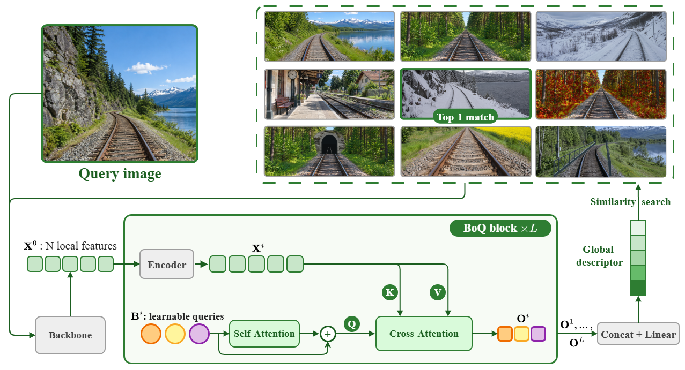

# Nordland Cross-Season Visual Place Recognition

Summer and winter can make the same stretch of railway look like two different places. This project matches summer query frames to winter reference frames from the Nordland railway dataset for OLP AI 2026. It uses a ResNet-50 backbone with Bag-of-Queries (BoQ) to turn each image into a descriptor, then ranks winter frames by cosine similarity.



## Task

Each query is a summer image. The database contains winter images from the same route. The system returns the `winter_id` of its top-ranked match for each `query_id`.

Frames with the same numeric position are aligned across seasons. A prediction counts as correct when its winter position is within 10 frames of the summer query position. The output file has two columns:

```csv
query_id,winter_id
images-01796,images-01796
```

## Dataset and preprocessing

The working dataset is `nordland-part-2020.zip`, with 1,750 frames per season, numbered 251 through 2000. The notebooks expect the archive at `data/nordland-part-2020.zip` and extracted images under `data/nordland-part-2020/summer/` and `data/nordland-part-2020/winter/`.

Preprocessing separates the route into a clean moving section (positions 251 to 1286), a stopped section (1287 to 1795), an independent moving holdout (1796 to 1871), and a tunnel section (1872 to 2000). The four validation folds use contiguous parts of the clean moving section with a 30-frame buffer around each fold. See [the preprocessing notebook](notebooks/Nordland_EDA_Preprocessing.ipynb) and [the fold builder](scripts/build_clean_folds.py) for the boundaries and split rules.

## Method

Training pairs summer and winter frames by position. The ResNet-50 backbone extracts local image features; BoQ aggregates them into an L2-normalized descriptor. Retrieval compares query and database descriptors with cosine similarity. The Nordland training runs use 320-pixel images, 64 learnable queries, two BoQ layers, and 8,192-dimensional descriptors.

## Setup

Create the Python environment and install the notebook dependencies:

```bash
conda env create -f environment.yaml
conda activate boq
pip install -r requirement.txt
```

Open the notebooks in Jupyter or another notebook editor. The training notebooks require a CUDA GPU. Place and extract the dataset at the paths above before running them; their local data cells expect both the archive and the extracted folder.

## Workflow

1. Run [Nordland EDA and preprocessing](notebooks/Nordland_EDA_Preprocessing.ipynb) to inspect route regions.
2. Run `python scripts/build_clean_folds.py` to write `data/splits/nordland_clean_4fold.csv`.
3. Open [four-fold training and ensemble inference](notebooks/BoQ_Nordland_VPR.ipynb) or [full clean training](notebooks/BoQ_Nordland_VPR_Full_Train.ipynb). Run the cells in order. Both notebooks save checkpoints, metrics, and predictions under `runs/`.

For inference on a separate set, place images in `test/queries/` and `test/database/` under `data/nordland-part-2020/`. The full training notebook also checks `runs/test/`. It writes a two-column `output.csv` in its run directory. Without a test folder, that output contains validation predictions.

## Results

The full clean training run reports 98.68% Recall@1, 100% Recall@5, and 100% Recall@10 on the 76-query moving holdout, using the ±10-frame match rule. Its best checkpoint was selected at epoch 7 of a 10-epoch run.

The four-fold experiment reports validation Recall@1 of 96.14%, 98.84%, 98.46%, and 97.30% for folds 0 to 3. The score-level ensemble reports 100% Recall@1 on the same 76-query holdout.

These results come from local splits and checkpoints generated under `runs/`. They are separate from any competition test score.

## Repository structure

```text
Nordland-Cross-Season-VPR/
├── data/
│   ├── nordland-part-2020/       # Extracted summer and winter frames
│   ├── nordland-part-2020.zip    # Original dataset archive
│   └── splits/                    # Preprocessing and fold manifests
├── docs/                          # Project notes and supporting documents
├── images/                        # Diagrams and retrieval examples
├── notebooks/
│   ├── Nordland_EDA_Preprocessing.ipynb
│   ├── BoQ_Nordland_VPR.ipynb
│   └── BoQ_Nordland_VPR_Full_Train.ipynb
├── runs/                          # Generated outputs (ignored by Git)
├── scripts/
│   ├── build_clean_folds.py       # Builds the four contiguous validation folds
│   ├── error_analysis.py          # Analyzes retrieval errors
│   └── frame_stats.py             # Computes frame-level statistics
├── src/
│   ├── dataloaders/               # Dataset loaders and data module
│   ├── backbones.py               # ResNet and DINOv2 backbones
│   ├── boq.py                     # Bag-of-Queries aggregation
│   ├── model.py                   # Training model
│   └── utils.py                   # Shared utilities
├── environment.yaml               # Conda environment
├── requirement.txt                # Notebook dependencies
├── train.py                       # General BoQ training entry point
└── README.md
```
